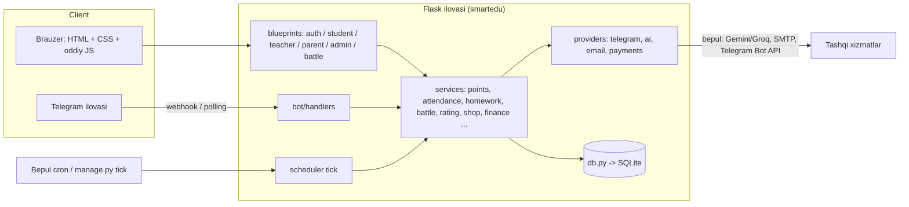

# Arxitektura

* Hamma SQL `db.py` orqali o'tadi (bitta joyda tranzaksiya, SAVEPOINT, migratsiya, zaxira). Baza — faqat SQLite; PostgreSQL qo'llab-quvvatlanmaydi.
* `providers/` — bepul variant standart; `.env` orqali pulliga almashadi.
* Battle: server vaqt chizig'i (started_at + i·(sek+tanaffus)), polling API, Elo (K 40 / 24), ligalar.
